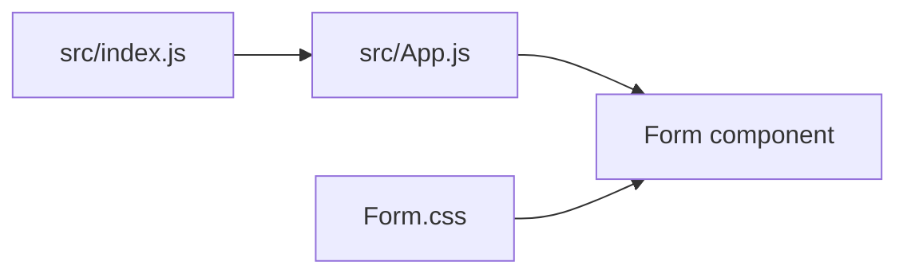

# React Login Form

**A small UI exercise for building and styling a login screen.**

This project focuses on the presentation of a college-email and password form. It is useful for practicing React component composition, CSS layout, input labels, and native form behavior.

## Current features

- A class-based React form component.
- Text and password inputs marked as required.
- A submit control and dedicated form stylesheet.
- Create React App development and build scripts.

The form is visual only. It does not verify credentials, create a session, or connect to an authentication API.

## Run locally

Download and extract the repository, then run:

```bash
npm install
npm start
```

Open the local address printed by React Scripts. Use sample values when exploring the form; it is not connected to an account system.

## Component structure



| File | Purpose |
|---|---|
| `src/App.js` | Renders the form |
| `src/Components/Form/Form.js` | Input and submit markup |
| `src/Components/Form/Form.css` | Form styling |
| `src/index.js` | React root initialization |

## Development notes

`npm run build` produces the static bundle. `npm test` starts the existing React Scripts test runner; the included starter test may not describe this custom form.

The component currently uses HTML-style attributes such as `class` and `for`, duplicate input IDs, and an empty form action. These should be corrected for React conventions, label accessibility, and controlled submission before extending it into a functional login flow. A password field alone does not provide authentication.

## Credits and contributions

Bootstrapped with [Create React App](https://github.com/facebook/create-react-app). Useful improvements include accessible labels, clear validation messages, and a documented authentication contract if a backend is added.
